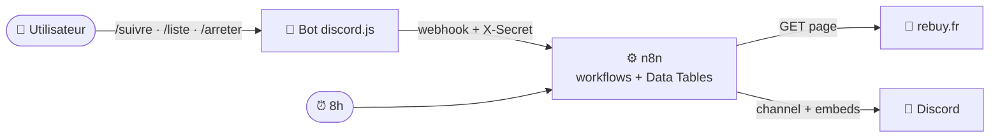

<p align="center">
  
</p>

<h1 align="center">rebuy-auto</h1>

<p align="center">
  Suit les <strong>prix de reprise Rebuy</strong> depuis Discord et poste un récap dès qu'un prix change.<br>
  Bot <code>discord.js</code> + workflows <strong>n8n</strong>, hébergé sur une instance Pterodactyl Node.js.
</p>

---

## Fonctionnement

1. Tu tapes `/suivre` avec un lien de reprise Rebuy.
2. Le bot crée un channel dédié au produit et y poste les prix actuels.
3. Chaque jour à 8h, n8n relève les prix. S'**il y a un changement**, un embed récapitulatif est posté dans le channel du produit.

| Commande | Effet |
|---|---|
| `/suivre lien:<url rebuy.fr/vendre/…>` | crée le channel du produit, le range dans la catégorie correspondant au lien (`/vendre/tablette/…` → « Tablettes », créée si absente), classe les salons de la catégorie par ordre alphabétique et démarre le suivi |
| `/liste` | liste les produits suivis avec leurs derniers prix |
| `/actualiser` | relève tout de suite tous les produits suivis et affiche un résumé (limité à un lancement par minute) |
| `/arreter` | arrête le suivi (à lancer dans le channel du produit) |

États suivis : **A0** neuf (emballage d'origine) · **A1** comme neuf · **A2** très bon état.

### Exemple d'embed

> **📱 Samsung Galaxy Tab S12 Plus 14,6” 256 Go [Wi-Fi] gris**
> Prix de reprise mis à jour
>
> 📈 **Neuf (emballage d'origine) : 521,90 €** (+8,00 €, +1,6 %) — avant : 513,90 €
> 📉 **Comme neuf : 493,43 €** (−6,57 €, −1,3 %) — avant : 500,00 €
> ➖ Très bon état : 469,70 € (inchangé)

La couleur de la bordure suit le mouvement global : 🟢 hausses · 🔴 baisses · 🟠 mixte · 🔵 premier relevé.

## Architecture



Le bot ne fait que recevoir les slash commands (n8n ne sait pas les recevoir) ; toute la logique métier vit dans n8n. Schémas détaillés (séquence `/suivre`, relevé quotidien, cycle de vie, modèle de données, démarrage) : **[docs/architecture.md](docs/architecture.md)**.

## Démarrage rapide

### Prérequis
- Une instance Pterodactyl avec l'egg **NodeJS** (Node 22) : ~4 Go de RAM conseillés pour n8n.
- Une application Discord avec un bot (permissions : *Manage Channels*, *Send Messages*, *Embed Links* ; scopes `bot` et `applications.commands`).

### Installation
1. **Panel** : *Git Repo Address* = ce dépôt, *Install Branch* = `main`, *Auto Update* = `1`, *Main file* = `start.js`, *User Uploaded Files* = `0`. Puis *Reinstall Server* pour le premier clone (token GitHub si le dépôt est privé).
2. **`.env`** à la racine du serveur, d'après [.env.example](.env.example).
3. **Démarrer** : le premier lancement installe n8n (plusieurs minutes). Ouvrir `http://IP:PORT` et créer **tout de suite** le compte propriétaire n8n.
4. **Credentials n8n** :
   - *Discord Bot API* (token, Application ID, Public Key) ;
   - *Header Auth* nommé `Rebuy Webhook Secret` : *Name* `X-Secret`, *Value* = `N8N_WEBHOOK_SECRET`.
5. **Data Tables n8n** : créer `rebuy_products` (`url`, `name`, `product_id`, `channel_id`, `guild_id`, `added_by` : string ; `last_a0`, `last_a1`, `last_a2`, `fail_count` : number ; `active` : boolean) et `rebuy_price_history` (`product_id` : string ; `a0`, `a1`, `a2` : number). Reporter leurs IDs, celui du credential Discord et `DISCORD_GUILD_ID` dans `.env` (`N8N_TABLE_*`, `N8N_DISCORD_CRED_ID`).
6. **Workflows** : créer les 5 workflows depuis [n8n/workflows.mjs](n8n/workflows.mjs) (`node --env-file=.env n8n/workflows.mjs <nom>`, via le MCP n8n), sélectionner le credential *Header Auth* dans les nœuds webhook, puis **publier** les workflows.
7. **Redémarrer** : les slash commands sont enregistrées automatiquement, le bot se connecte.

Détails, variables et dépannage : **[docs/exploitation.md](docs/exploitation.md)**.

## Workflows n8n

| Workflow | Déclencheur | Rôle |
|---|---|---|
| Rebuy – Relevé quotidien | cron 8h (Europe/Paris) | relève les produits actifs, poste l'embed si un prix change, alerte après 3 échecs |
| Rebuy – Ajouter un produit | `POST /webhook/rebuy-add` | lit la page, crée le channel, poste le récap initial, enregistre |
| Rebuy – Lister les produits | `POST /webhook/rebuy-list` | répond avec la liste |
| Rebuy – Actualiser les suivis | `POST /webhook/rebuy-refresh` | relève tout de suite tous les produits, poste les changements, renvoie un résumé |
| Rebuy – Arrêter le suivi | `POST /webhook/rebuy-remove` | désactive le suivi du channel |

Données dans deux Data Tables n8n : `rebuy_products` et `rebuy_price_history`.

## Structure du dépôt

```
.
├── start.js              point d'entrée Pterodactyl : n8n + bot, slash commands, rebuild sqlite3
├── src/
│   ├── index.js          bot discord.js (slash commands → webhooks n8n)
│   ├── commands.js       définition des slash commands
│   ├── rebuy.js          lecture des prix dans la page Rebuy (JSON embarqué #ry-inject)
│   └── embed.js          comparaison des relevés et construction de l'embed
├── deploy-commands.js    enregistre les slash commands auprès de Discord
├── n8n/
│   ├── workflows.mjs     génère le code SDK des 5 workflows
│   └── lib.mjs           code des nœuds Code, construit depuis src/
├── docs/                 architecture (Mermaid) et exploitation
├── assets/               logo du bot (SVG + PNG)
├── test.mjs              tests (node:assert)
└── CLAUDE.md             consignes pour Claude Code
```

## Développement

```bash
npm install
npm test                                  # diff de prix, embed, parseur
npm run spike -- "<lien rebuy>"           # affiche nom, image et prix A0-A2 d'un lien
node n8n/workflows.mjs quotidien          # génère le code SDK d'un workflow (ajout, liste, retirer…)
```

Commits au format `<gitmoji> <type>(scope): message` (Conventional Commits).

## Limites

Rebuy n'a pas d'API publique : le prix est lu dans le JSON embarqué de la page. Si le site change sa structure, la lecture échoue et le bot alerte dans le channel du produit après 3 relevés ratés (voir [docs/exploitation.md](docs/exploitation.md#limites-connues)).
