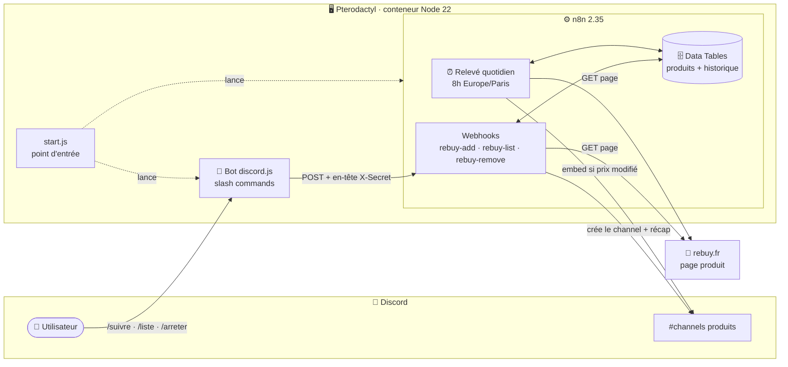
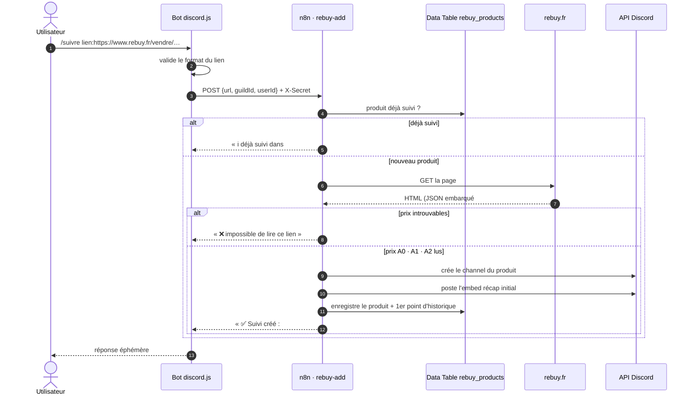
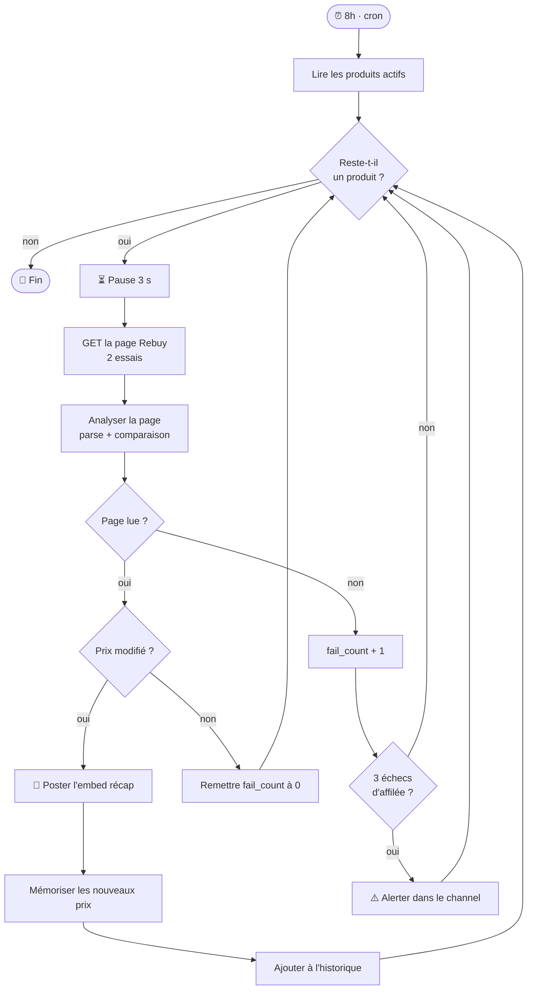
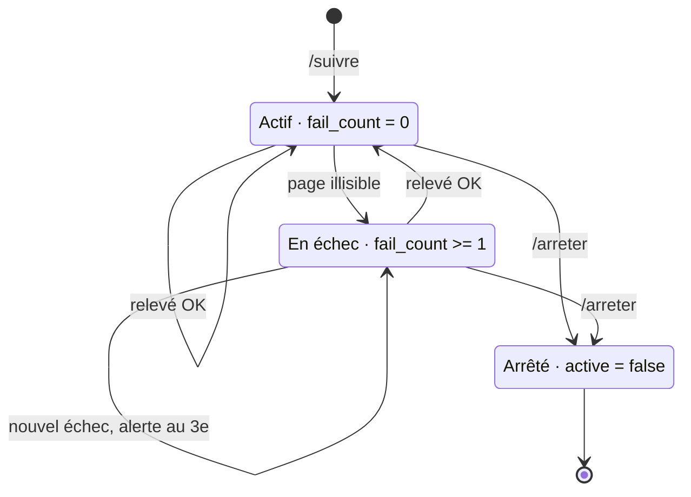
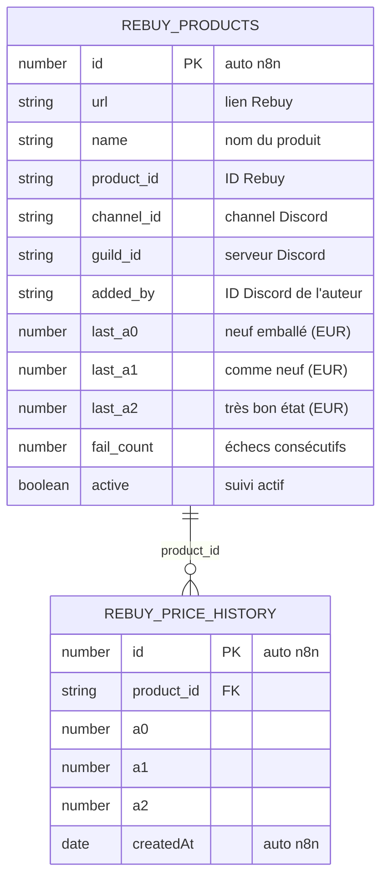
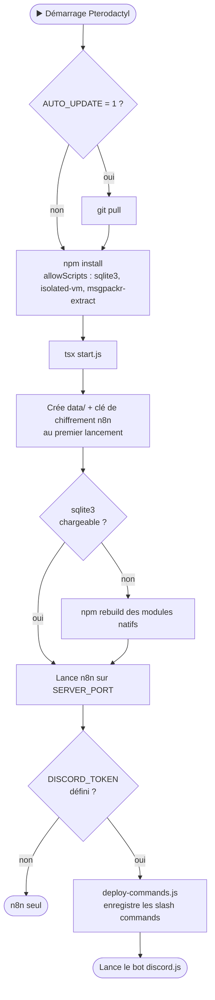
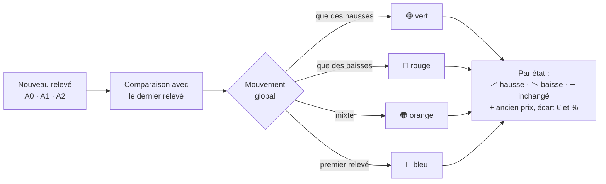

# Architecture

Tous les schémas sont en [Mermaid](https://mermaid.js.org/) (rendus nativement par GitHub).

## Vue d'ensemble

## `/suivre` : ajout d'un produit

## Relevé quotidien

## Cycle de vie d'un suivi

## Modèle de données

## Démarrage du conteneur

## Format de l'embed

